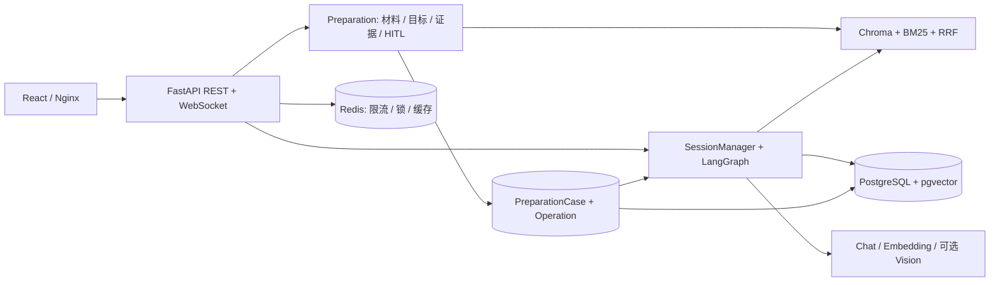

# Mockview

Mockview 是面向开发者的 JD 与简历驱动面试练习项目。先把岗位要求、候选人材料与历史观察转成可追溯的考察目标，再检索证据、逐题生成问题、追问并输出报告。它用于个人练习，不用于自动招聘决策。

项目由所有者自建，使用 Codex 辅助开发。当前业务功能冻结，处于发布准备阶段：项目许可证尚待所有者选择，历史语料的公开范围仍待确认。公开示例仅使用新编写的合成数据，见 [来源与许可](THIRD_PARTY.md)。

## 主要功能

| 默认主流程 | 实现边界 |
| --- | --- |
| JD、PDF/图片简历与项目补充 | 生成岗位能力矩阵、材料引用与考察目标；PDF 文本提取与图片 Vision 路径不同，不保证扫描 PDF 自动 OCR |
| Preparation 与 HITL | 材料 revision、目标、证据、澄清和持久 operation；刷新恢复当前账号最近准备任务 |
| 有证据的出题 | Chroma + BM25 + RRF、父子块检索、逐评分点引用检查；证据不足的目标不进入准备面试出题集合 |
| 实时面试 | Practice 与 Professional 双轮图、渐进出题、追问、暂停恢复及提前结束；JWT 首帧 WebSocket 鉴权 |
| 评价与报告 | 同题全部问答形成最终评价，再聚合技能分/总分；不可评分保持 null；历史、Markdown 与打印 HTML 使用同一报告 |
| 复练与长期观察 | 从有效最终评价选择弱项，关联原 Session/case/revision，重新准备证据；观察异议与画像重算 |

有界 Tool Calling 补查、公开搜索、语义校验和 shadow 是**显式可选实验**，默认关闭。跨会话语义去重尚未实现，也不承诺每道题都体现简历项目细节。CLI/Gradio 是不受支持的历史入口。

## 系统概览



Python 3.11、FastAPI/Pydantic、LangGraph、PostgreSQL 16/pgvector、Redis 7、Chroma；前端使用 Node 22、React 19、TypeScript、Vite 6。多 Agent 指图内多职责节点，不是自治 Agent 团队。完整部署保持单 API 进程、单 worker。

## 快速启动

官方推荐入口是根目录 **Docker Compose**。需要 Compose 2.24+、可用的模型服务与独立数据目录。在新目录取得经发布清单确认的源码；现有开发区不能直接当作干净发布包。

1. 复制 `.env.example` 为 `.env`；已有文件不覆盖。
2. 配置自己的 Chat/Embedding 地址、模型名与 key。示例模型名不是可用性保证。
3. 分别生成独立随机 `AUTH_SECRET_KEY` 和 URL-safe `POSTGRES_PASSWORD`。可在本机运行 `python -c "import secrets; print(secrets.token_urlsafe(48))"`，真实值只保存在本地。
4. 在全新目录执行：

```bash
docker compose build
docker compose up -d postgres redis
docker compose run --rm api python -m scripts.init_vector_store
docker compose up -d api web
docker compose ps
```

索引初始化会调用 Embedding 服务。公开合成题库只有 RAG 示例；更多岗位需要自行添加有权使用的材料。不要在已有索引上盲目使用 `--reset`。数据库业务表、迁移和 checkpoint 表由 API 启动初始化。

默认 Web：`http://127.0.0.1`；API 文档：`http://127.0.0.1:8000/docs`；健康检查：`/health`。公网展示前需配置 HTTPS/WSS、访问控制与自有凭据，见 [部署指南](DEPLOYMENT.md)。

登录后按“JD/简历 → 分析证据并准备面试 → 按需澄清 → 按目标开始面试”操作。兼容快速入口跳过准备，个性化与证据门禁边界不同，不作为推荐演示入口。

## 演示与验证

[演示说明](docs/demo.md) 提供操作路线与截图规范。当前不放置真实简历或个人会话截图，也不把 Mock 验收当作真实模型效果。

在干净源码副本、无真实 `.env` 的 Python 3.11 环境中执行精选测试：

```bash
python -m pip install -r requirements-dev.txt
python -m pytest -q tests/test_phase3_closure.py tests/test_preparation_api.py tests/test_public_interview_security.py tests/test_closeout_correctness.py
cd web
npm ci
npm run build
```

具体隔离方式、验证结果与边界见 [验证方法](docs/evaluation.md)。这不是全量回归或模型质量评测；历史实验脚本有独立数据依赖。

## 目录与文档

```text
app/                      API、图节点、证据、RAG、记忆与持久化
web/                      当前受支持的 React 客户端
scripts/                  启动、索引初始化和分类后的评测工具
tests/fixtures/           独立合成测试材料
data/question_bank/       合成示例；其他语料需来源确认
docs/                     当前架构、机制、验证与限制
requirements*.txt/.lock   运行、测试、实验和历史 UI 的依赖入口
```

| 文档 | 内容 |
| --- | --- |
| [部署](DEPLOYMENT.md) | 推荐入口、配置、初始化和本地开发 |
| [架构](docs/architecture.md) | Preparation / Interview 与组件职责 |
| [RAG 与证据](docs/rag-and-evidence.md) | 检索、充分性、引用与实验 |
| [面试运行时](docs/interview-runtime.md) | 图、评分、幂等、恢复与预算 |
| [验证](docs/evaluation.md) | 精选测试、干净构建和指标边界 |
| [限制](docs/limitations.md) | 已知问题与单 worker 边界 |
| [脚本分类](scripts/README.md) | 必要入口、评测、历史诊断 |
| [来源与许可](THIRD_PARTY.md) | 所有者声明、图标、依赖与待确认项 |
