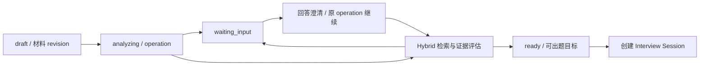

# 架构：Preparation 与 Interview

推荐运行拓扑是 React/Nginx → FastAPI → PostgreSQL/pgvector、Redis、Chroma 和外部模型服务；完整应用单 worker。组件关系见 README，安装细节集中在 DEPLOYMENT，本文描述实际源码职责。

## Preparation：先建立可出题条件

`app/api/preparation.py` 提供 case、材料上传、analysis、progress、clarification、repractice、interviews API。`preparation_service.py` 将 JD、简历、项目说明和历史观察变成 AssessmentTarget；目标包含稳定技能身份、材料引用、revision、验证目标和 gap_kind。

case.status 与 operation.status 是不同概念。材料分析完成并不代表所有目标证据充分；页面展示可出题与未解决目标，启动还检查 ready、无 pending clarification、存在充分证据目标。默认 `JobAssessmentAgent` 走确定性检索/评估；自主工具循环仅在显式打开开关后参与补缺。

operation 有 accepted/running/waiting_input/succeeded/failed_retryable/failed/cancelled；其 result、remaining budget、事件和工具调用记录落 PostgreSQL。GET progress 读取当前 revision 的原 operation；刷新本身不调用 LLM。浏览器只保存当前用户最近 case 指针与面试参数，不把材料正文存成恢复状态。

## Interview：从冻结材料进入问答图

`SessionManager` 接收 case 的 targets、材料版本和证据快照，创建稳定 Session；REST 和 WebSocket 都经归属检查。`app/agents/graph.py` 编排 practice 或 professional；节点包括分析/规划、当前题生成、提问、过程评估、追问、最终单题评价和综合报告。

图的职责是业务状态流转；SessionManager 负责后台任务、恢复、事件、答案幂等和持久化边界。LangGraph checkpoint 不能替代业务 Session 表，也不等于请求副作用自动恰好一次。

复练从已完成 Session 的有效最终评价提取低于 8 分的技能，关联原 case/revision。新 case 具有独立 target ID、重新准备证据，并保存 source_question_ids 供追溯；该字段不是跨会话语义去重实现。源材料 revision 已变化且无完整旧材料快照时返回 409。

## 数据与运行职责

| 组件 | 职责与限制 |
| --- | --- |
| FastAPI | JWT、归属检查、上传限制、REST/WS 协议、公开数据投影；内部 evidence 不等于可全部发送给前端 |
| LangGraph | 条件路由、interrupt_before、checkpoint 和问答节点；多职责节点，不是自主多 Agent 团队 |
| PostgreSQL | 用户、case/target/clarification、operation/tool call、Session、事件、checkpoint、长期观察 |
| pgvector | 长期记忆语义检索；不是题库主向量库 |
| Redis | admission/限流、回答锁、在线状态、Session snapshot/report 缓存；准备入口不可用时拒绝新任务 |
| Chroma | 题库父子 chunk 向量索引；BM25 从该集合的文本构建，不是另一个人工维护题库 |
| 模型客户端 | Chat、结构化输出、stream、Vision、Embedding；超时、实际请求计数与可选代理 |

API 初始化 database/migrations/checkpointer；内存/SQLite fallback 为离线实验或兼容实现，不能据此宣称完整应用无数据库也能启动。实验开关和限制见对应文档。
